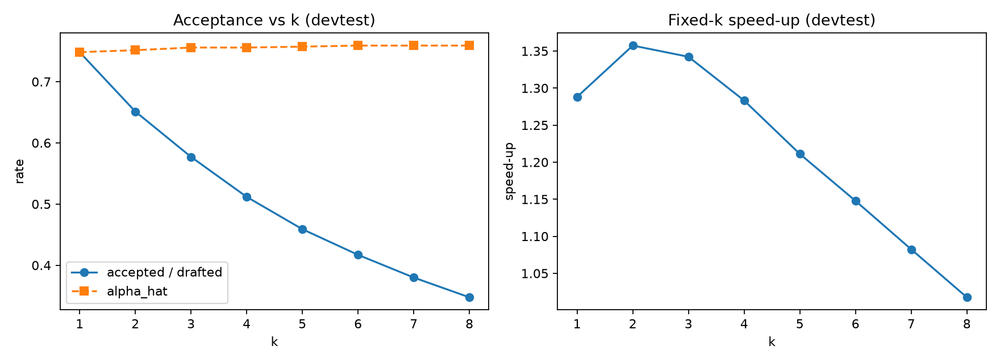
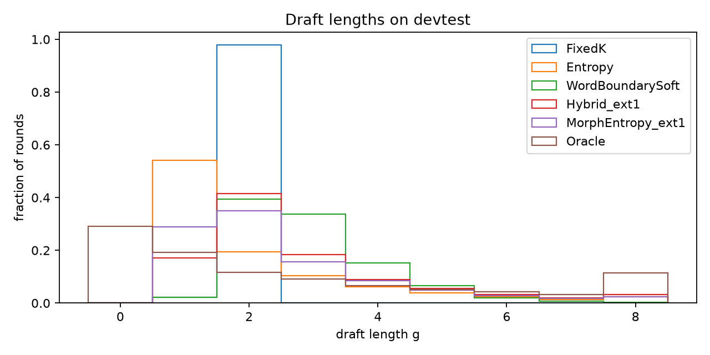
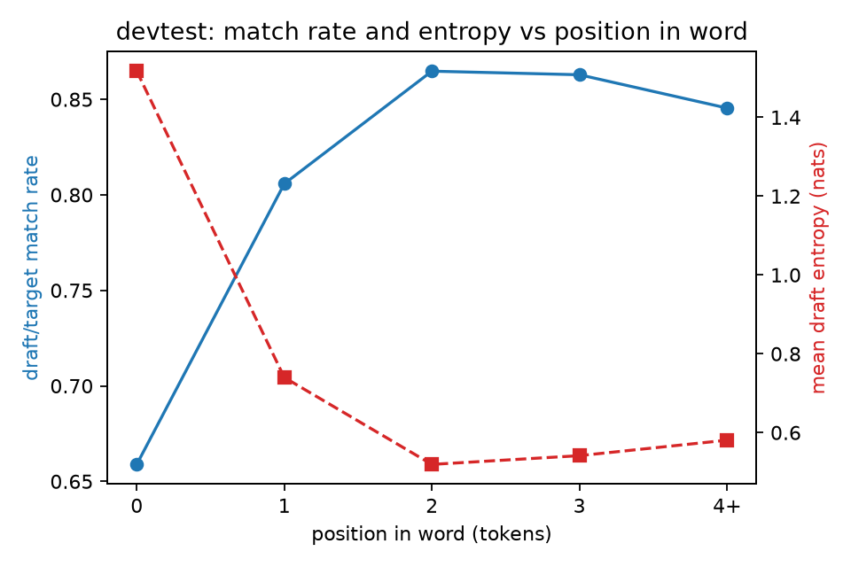

# Phase 1 report: linguistically guided stopping for speculative decoding in Hindi

CS769 course project (Kanika, Rakshit). This report is generated by `scripts/make_report.py` from the files in `results/phase1/`, so every number has a source file. It covers Phase 1 of `PLAN_phase1_bugfix.md`: the bugs found in the earlier notebooks, the rebuilt pipeline, and the corrected results.

## 1. Summary

**Question.** Does linguistic structure (word, morpheme, akshara boundaries) predict where a draft model's tokens get rejected, beyond what the draft model's own confidence (entropy) already tells us? And can it be used to choose better draft lengths?

**Answer on this setup (Llama-3-8B target, Llama-3.2-1B draft, English→Hindi FLORES+): no.**

- The best policy is the entropy rule: **1.452×** [1.444, 1.461] on devtest, against 1.357× for the best fixed draft length (k=2) and 1.904× for the oracle (an upper bound that knows where each draft fails). Entropy closes 17.3% of the gap between fixed-k and the oracle.
- No linguistic policy beats it. The best one is MorphEntropy_ext1 at 1.427× (Δ -0.025 [-0.028, -0.022]). Policies that look one token ahead lose even when that extra draft step is free: the best is AksharaSafeEntropy at 1.430×. Stopping at the true word boundaries (an oracle) gives only 1.353×.
- Drafts do fail more at the start of a word: the draft matches the target on 65.9% of word-initial tokens, against 86.5% of third tokens in a word. But at equal entropy, word-initial tokens match +1.4 points [+0.8, +2.0] *more* often. Adding word and morpheme position to a model of draft failure that already uses entropy changes AUC by -0.0001 [-0.0004, +0.0000].
- The old linguistic results were invalid because of bugs B1–B3 (§3). In particular, the old "morpheme" row never used MorphTok. The fixed-k, entropy and oracle numbers reproduce the old protocol within 0.029.
- Real draft-and-verify loop (wall-clock speed-up, losslessness, simulator accuracy): ⟨pending: Kaggle notebook 03 → notebook 04⟩ (§9).

## 2. Setup

| item | setting |
|---|---|
| Target model | meta-llama/Meta-Llama-3-8B-Instruct, fp16, layer-split over 2× T4 (`max_memory` 8/10 GiB) |
| Draft model | meta-llama/Llama-3.2-1B-Instruct, fp16, GPU 0 (same tokenizer, asserted) |
| Task | English→Hindi translation, FLORES+ (`openlanguagedata/flores_plus`), chat prompt, greedy, MAX_NEW=256 |
| Tuning set | FLORES+ **dev**: 997 sentences, 63173 target tokens |
| Test set | FLORES+ **devtest**: 1012 sentences, 66106 target tokens |
| Cost model | round with g drafted tokens costs g·c + verify(g) target-step units; c = 0.323; verify(1..8) = 1.020 … 1.074 (measured) |
| Speed-up | tokens emitted / total cost; plain greedy decoding = 1.0 |
| Draft cap | γ_max = 8 for every dynamic policy (fixed-k: k) |
| Statistics | 95% CIs: bootstrap over sentences, 1000 resamples; paired bootstrap for differences |

**Causality rule (PLAN §3).** A policy may only read what a real decoder knows when it decides. After drafting g tokens from committed position p, that is the draft distributions q_p … q_{p+g−1}, the drafted tokens, and the committed target tokens. A *lookahead* policy may also read q_{p+g}, which costs one extra draft forward: we charge c whenever the policy stops by itself, and report the uncharged bound as well. A `TraceView` guard raises `CausalityError` on any other read (enforced in the simulator and in tests).

**Teacher-forcing approximation.** Traces are computed with the target output as context. Accepted tokens are exact (draft and target agree up to the first mismatch); only the stopping decision after a mismatch can differ from a real loop. §9 measures the size of this gap.

## 3. What was wrong before, and what was done

| bug | problem | fix |
|---|---|---|
| B1 | "Morpheme lookup" used an 11-word placeholder, not MorphTok | Real tiered labeller (gold → CRF) + causal prefix-boundary model; MorphEntropy / MorphOnly policies (T3, T6) |
| B2 | Hybrid had no entropy gate; its akshara check was almost always true (it depends on the *next* token) | Entropy gate restored; akshara/word completeness from next-token probabilities (`p_mark`, `p_newword`), lookahead declared (T5) |
| B3 | Word-boundary policy read an undrafted token for free | Lookahead declared and charged; causality guard (T4) |
| B4 | Single byte-level tokens decoded on their own (`\ufffd`) | Byte-level `token_to_bytes` + byte offsets everywhere (T1) |
| B5 | Boundaries computed on draft tokens | Gold labels from the target output text (T2) |
| B6 | Correlation sign ignored; auto-generated "insight" text | Signed point-biserial r with CIs, descriptive tables, conditional analysis (T8) |
| B7 | Only entropy was tuned | Every policy family gets a dev grid (T7) |
| B8 | Inconsistent evaluation sets | Tune on FLORES+ dev, report on devtest, bootstrap CIs (T0, T7) |
| B9 | Batched generation vs losslessness | Real loop compared against *unbatched* greedy output (T9) |

**Tasks.** T0 scaffolding (package `lgmtp`, tests, legacy notebooks moved unchanged to `notebooks/legacy/`) · T1 `boundaries.py` · T2 `vocab.py`, `traces.py`, `gpu_traces.py`, Kaggle notebook 01 · T3 `morph.py` · T4 `simulator.py` · T5/T6 `policies.py` · T7 `tuning.py`, `stats.py`, notebook 02 · T8 `analysis.py` · T9 `spec_loop.py`, Kaggle notebook 03, notebook 04 · T10 `docs/slide_corrections.md`. Every GPU code path was smoke-tested on CPU first (`scripts/smoke_cpu.py`, with Llama-3.2-1B as both target and draft).

**Decisions not covered by the plan (made with the user):**

- MorphTok: the user's local copy of `hindi.csv` was used (sha256 recorded in `morphtok_info.json`); no Hugging Face revision is available for it.
- Words with several MorphTok segmentations: union of boundaries. Gold boundaries inside an akshara (e.g. निकाल+ेगी): moved left to the start of that akshara.
- Qwen3.5 tokenizer: report the real 2.16 tokens/word; the old 3.33 is explained as a loading artifact (§4).
- Grids for the policies built on entropy: λ = the entropy dev-best ± 5 grid steps × all β; grids for MorphEntropy / MorphOnly as in `tuning.py`.
- Selected MorphEntropy / Hybrid configs had max_ext = 0, which makes them equal to Entropy. Both are reported, plus constrained variants (`*_ext1`, max_ext ≥ 1) that do use their linguistic condition.
- Conditional analysis added to T8 (§8.3), because it answers the main question directly.

## 4. Tokenizer analysis (T1)

Re-run of the original Test 1 on FLORES+ devtest Hindi through `lgmtp.boundaries` (`notebooks/00_tokenizer_analysis.ipynb`).

| tokenizer | tokens / word | cuts at word boundary | cuts inside akshara | k=4 draft ends inside word |
|---|---|---|---|---|
| meta-llama/Llama-3.2-1B-Instruct | 2.67 | 38.6% | 54.3% | 60.6% |
| Qwen/Qwen3.5-0.8B | 2.16 | 51.2% | 19.2% | 47.3% |
| Qwen/Qwen3.5-0.8B [legacy Qwen2 regex] | 3.33 | 33.0% | 46.4% | 66.4% |

Regression against the old numbers: 5/5 checks pass (`test1_regression.csv`). The old Qwen figure (3.33 tokens/word) came from an older transformers loading path that applied the Qwen2 pre-tokenizer regex (it splits before every matra). With the model's own `tokenizer.json`, Qwen3.5-0.8B gives 2.16; swapping in the old regex reproduces 3.33.

## 5. Traces (T2)

Kaggle notebook 01 (2× T4) generated 8B greedy outputs and ran teacher-forced passes of both models, storing per-position draft features (entropy H, top-1/top-2 probability, the probability that the next token starts with a space / punctuation / end-of-sequence / a combining mark / mid-character, top-20 draft and target log-probabilities).

| split | sentences | tokens | draft = target | mean H (match) | mean H (mismatch) | target argmax = output | hit MAX_NEW |
|---|---|---|---|---|---|---|---|
| dev | 997 | 63173 | 76.1% | 0.658 | 2.058 | 99.91% | 1 |
| devtest | 1012 | 66106 | 76.1% | 0.659 | 2.090 | 99.90% | 0 |

Acceptance checks (`traces_summary.json`): devtest agreement within 2 points of the old 0.761: **True**; c within 10% of the old 0.334: **True** (c = 0.323). The few positions where the target's own argmax differs from its output are fp16 near-ties.

## 6. Morpheme labelling (T3)

| MorphTok | count |
|---|---|
| MorphTok rows | 72257 |
| kept (pieces join back into the word) | 61766 |
| dropped (sandhi splitting) | 10491 |
| gold lexicon words | 60721 |
| words with several segmentations (union) | 1045 |
| internal boundaries (raw) | 47360 |
| boundaries inside an akshara, moved left | 4916 |

**CRF segmenter** (character-level, held-out 10% of word types): boundary precision 0.924, recall 0.930, **F1 0.927**, exact-word accuracy 0.899. Baseline "boundary at every akshara": F1 0.438. Caveat: held-out words often share stems with training words, so accuracy on unseen stems is likely lower.

| target outputs | word tokens | gold | CRF | none (non-Devanagari) | word types | types gold | types CRF |
|---|---|---|---|---|---|---|---|
| dev | 23596 | 66.5% | 31.7% | 1.7% | 5144 | 34.6% | 60.2% |
| devtest | 24651 | 66.9% | 31.4% | 1.6% | 5310 | 35.4% | 59.4% |

The causal **prefix-boundary model** P(boundary | word prefix) uses backoff (full prefix → last 3 / 2 / 1 aksharas → global rate, minimum count 5). It is built from MorphTok and the dev outputs only, never devtest (`prefix_model.pkl.gz`).

## 7. Simulator check against the old protocol (T4)

The old evaluation protocol (random half split of devtest, entropy grid with β ∈ {0.5, 1, 2}, unit verify cost), re-run on the new traces:

| policy | new traces | old PDF | gap |
|---|---|---|---|
| fixed k=2 | 1.378 | 1.361 | +0.017 |
| entropy | 1.473 | 1.452 | +0.021 |
| oracle (cap 8) | 1.934 | 1.905 | +0.029 |

All gaps are within 0.03 (`legacy_protocol.json`), so generation and the ported simulator are consistent with the old run.

## 8. Policies and main results (T5–T8)

### 8.1 Policies

| policy | lookahead | rule |
|---|---|---|
| FixedK | 0 | draft exactly k tokens |
| Entropy | 0 | stop when 1 − √(β·H) < λ (AdaEDL/SVIP-style), H = entropy of the last draft distribution |
| WordBoundarySoft | 1 | stop when g ≥ min_g and P(next token starts a new word) > τ |
| WordBoundaryHard | 1 | stop when g ≥ min_g and the draft's next token starts a new word (corrected old policy) |
| AksharaSafeEntropy | 1 | entropy rule, but stop only if P(next token is a combining mark) < τ_m; else extend ≤ max_ext |
| Hybrid | 1 | entropy rule, but stop only if P(next token starts a new word) > τ_w; else extend ≤ max_ext |
| MorphEntropy | 0 (1 with akshara check) | entropy rule, but stop only if P(morpheme boundary | word prefix) > τ_morph; else extend ≤ max_ext |
| MorphOnly | 0 | stop when g ≥ min_g and P(morpheme boundary | word prefix) > τ_morph |
| Oracle | — | stop exactly before the first mismatch (upper bound) |
| GoldWordOracle | — | stop at the true word boundaries of the target (upper bound for word-boundary stopping) |
| *_ext1 | as base | same family, grid restricted to max_ext ≥ 1 (the linguistic condition is used) |

Grid sizes on dev: FixedK 8, Entropy 160, NoDraft 1, WordBoundarySoft 57, WordBoundaryHard 3, AksharaSafeEntropy 528, Hybrid 704, MorphEntropy 3168, MorphOnly 57, Oracle 1, GoldWordOracle 3, Hybrid_ext1 528, MorphEntropy_ext1 2376 (`grid_*.csv`). Selection: best dev speed-up with the lookahead step charged (`selected_params.json`).

### 8.2 Main table (devtest)

| policy | LA | speed-up | CI low | CI high | uncharged | accept rate | draft len | tokens/verif | Δ vs Entropy | P(better) | oracle gap closed |
|---|---|---|---|---|---|---|---|---|---|---|---|
| Oracle | — | 1.904 | 1.895 | 1.914 | 1.904 | 100.0% | 2.630 | 3.577 | +0.452 | 1.00 | 100.0% |
| MorphEntropy | 0 | 1.452 | 1.444 | 1.461 | 1.452 | 71.9% | 2.102 | 2.479 | +0.000 | 0.00 | 17.3% |
| Entropy | 0 | 1.452 | 1.444 | 1.461 | 1.452 | 71.9% | 2.102 | 2.479 | +0.000 | 0.00 | 17.3% |
| MorphEntropy_ext1 | 0 | 1.427 | 1.418 | 1.437 | 1.427 | 66.0% | 2.534 | 2.640 | -0.025 | 0.00 | 12.7% |
| FixedK | 0 | 1.357 | 1.350 | 1.366 | 1.357 | 65.1% | 1.978 | 2.259 | -0.094 | 0.00 | 0.0% |
| GoldWordOracle | — | 1.353 | 1.345 | 1.361 | 1.353 | 64.4% | 1.966 | 2.248 | -0.099 | 0.00 | -0.9% |
| MorphOnly | 0 | 1.343 | 1.335 | 1.353 | 1.343 | 59.6% | 2.539 | 2.486 | -0.108 | 0.00 | -2.6% |
| Hybrid | 1 | 1.253 | 1.243 | 1.264 | 1.424 | 63.3% | 2.979 | 2.844 | -0.199 | 0.00 | -19.1% |
| AksharaSafeEntropy | 1 | 1.239 | 1.231 | 1.249 | 1.430 | 64.6% | 2.773 | 2.759 | -0.212 | 0.00 | -21.6% |
| Hybrid_ext1 | 1 | 1.235 | 1.226 | 1.244 | 1.426 | 64.3% | 2.781 | 2.753 | -0.217 | 0.00 | -22.5% |
| WordBoundarySoft | 1 | 1.161 | 1.152 | 1.171 | 1.341 | 57.5% | 2.945 | 2.664 | -0.291 | 0.00 | -36.0% |
| WordBoundaryHard | 1 | 1.144 | 1.135 | 1.154 | 1.317 | 55.3% | 3.101 | 2.683 | -0.308 | 0.00 | -39.0% |
| NoDraft | 0 | 1.000 | 1.000 | 1.000 | 1.000 | 0.0% | 0.000 | 1.000 | -0.452 | 0.00 | -65.4% |

LA = lookahead. *speed-up* has the lookahead step charged; *uncharged* is the optimistic bound. Δ vs Entropy and P(better) come from a paired bootstrap. Notes on selected configs:

- **Hybrid**: max_ext=0: Entropy + charged lookahead (word condition never changes the decision)
- **MorphEntropy**: reduces to Entropy (max_ext=0: morph model never consulted)

Selected parameters:

| policy | dev-selected params |
|---|---|
| FixedK | {"k": 2} |
| Entropy | {"lam": -0.683, "beta": 4.0} |
| NoDraft | {} |
| WordBoundarySoft | {"tau": 0.05, "min_g": 2} |
| WordBoundaryHard | {"min_g": 2} |
| AksharaSafeEntropy | {"lam": -0.746, "beta": 4.0, "tau_m": 0.7, "max_ext": 1} |
| Hybrid | {"lam": -0.621, "beta": 2.0, "tau_w": 0.2, "max_ext": 0} |
| MorphEntropy | {"lam": -0.683, "beta": 4.0, "tau_morph": 0.1, "use_akshara": false, "tau_m": 0.5, "max_ext": 0} |
| MorphOnly | {"tau_morph": 0.05, "min_g": 2} |
| Oracle | {} |
| GoldWordOracle | {"min_g": 1} |
| Hybrid_ext1 | {"lam": -0.683, "beta": 4.0, "tau_w": 0.2, "max_ext": 1} |
| MorphEntropy_ext1 | {"lam": -0.621, "beta": 4.0, "tau_morph": 0.1, "use_akshara": false, "tau_m": 0.5, "max_ext": 1} |


Where do drafts end? Fraction of drafts whose last token sits at a word boundary, inside an akshara, or at a morpheme boundary of the target:

| policy | ends at word boundary | ends inside akshara | ends at morpheme boundary |
|---|---|---|---|
| FixedK | 41.3% | 52.5% | 42.7% |
| Entropy | 30.5% | 61.7% | 31.9% |
| WordBoundarySoft | 92.7% | 5.6% | 93.5% |
| WordBoundaryHard | 97.8% | 1.6% | 98.0% |
| AksharaSafeEntropy | 59.6% | 28.6% | 62.1% |
| Hybrid | 27.0% | 64.7% | 28.4% |
| MorphEntropy | 30.5% | 61.7% | 31.9% |
| MorphOnly | 43.5% | 50.1% | 45.4% |
| Oracle | 63.2% | 33.1% | 64.2% |
| GoldWordOracle | 100.0% | 0.0% | 100.0% |
| Hybrid_ext1 | 62.0% | 31.3% | 63.8% |
| MorphEntropy_ext1 | 41.8% | 50.1% | 44.0% |

The word and akshara policies do end drafts where they intend to (e.g. WordBoundarySoft 92.7% at word boundaries), but those drafts are longer and get rejected more often, so they are slower.

Fixed draft length (devtest):

| k | acceptance_rate | alpha_hat | tokens_per_verif | mean_draft_len | speedup |
|---|---|---|---|---|---|
| 1 | 74.8% | 0.748 | 1.730 | 1.000 | 1.288 |
| 2 | 65.1% | 0.751 | 2.259 | 1.978 | 1.357 |
| 3 | 57.7% | 0.756 | 2.662 | 2.940 | 1.342 |
| 4 | 51.2% | 0.756 | 2.949 | 3.888 | 1.283 |
| 5 | 45.9% | 0.757 | 3.169 | 4.824 | 1.211 |
| 6 | 41.7% | 0.759 | 3.350 | 5.751 | 1.148 |
| 7 | 38.0% | 0.759 | 3.481 | 6.663 | 1.082 |
| 8 | 34.8% | 0.759 | 3.577 | 7.566 | 1.018 |






### 8.3 Where do drafts fail? (T8)

By position of the token in its word (gold labels from the target text):

| position in word | count | mean_H | match_rate | mean_p_target | frac |
|---|---|---|---|---|---|
| 0 | 26852 | 1.517 | 65.9% | 0.537 | 40.6% |
| 1 | 21965 | 0.740 | 80.6% | 0.735 | 33.2% |
| 2 | 10189 | 0.519 | 86.5% | 0.812 | 15.4% |
| 3 | 4609 | 0.541 | 86.3% | 0.808 | 7.0% |
| 4+ | 2491 | 0.581 | 84.5% | 0.795 | 3.8% |



By where the token starts:

| start_kind | count | mean_H | match_rate | mean_p_target | frac |
|---|---|---|---|---|---|
| mid-akshara | 34998 | 0.627 | 83.4% | 0.771 | 52.9% |
| mid-utf8 | 74 | 0.311 | 95.9% | 0.925 | 0.1% |
| mid-word | 4182 | 0.841 | 80.1% | 0.736 | 6.3% |
| word-initial | 26852 | 1.517 | 65.9% | 0.537 | 40.6% |

By whether a morpheme or word boundary follows the token:

| morph_boundary_after | count | mean_H | match_rate | mean_p_target | frac |
|---|---|---|---|---|---|
| False | 38396 | 1.259 | 71.6% | 0.613 | 58.1% |
| True | 27710 | 0.645 | 82.2% | 0.758 | 41.9% |

By token type:

| token_type | count | mean_H | match_rate | mean_p_target | frac |
|---|---|---|---|---|---|
| devanagari | 62774 | 1.005 | 76.0% | 0.672 | 95.0% |
| digit | 561 | 0.643 | 84.5% | 0.788 | 0.8% |
| latin | 382 | 2.230 | 35.1% | 0.297 | 0.6% |
| other | 138 | 2.629 | 13.0% | 0.112 | 0.2% |
| punct | 994 | 1.148 | 74.5% | 0.629 | 1.5% |
| space/special | 1257 | 0.310 | 95.1% | 0.919 | 1.9% |

Signed point-biserial correlations of draft entropy H with labels (95% CI, bootstrap over sentences):

| pair | r | lo | hi | r (dev) |
|---|---|---|---|---|
| H vs word_initial | +0.375 | +0.367 | +0.382 | +0.371 |
| H vs end_cut==WORD | -0.243 | -0.249 | -0.237 | -0.239 |
| H vs match | -0.537 | -0.543 | -0.530 | -0.528 |
| H vs morph_boundary_after | -0.266 | -0.272 | -0.260 | -0.262 |

**Beyond confidence.** (a) Difference in match rate between word-initial and other tokens (and between morpheme-initial and other tokens), raw and *within entropy deciles* (count-weighted mean of the within-decile differences, 95% sentence-bootstrap CI):

| split | label | raw difference | entropy-adjusted | CI low | CI high |
|---|---|---|---|---|---|
| devtest | word_initial | -17.1 pts | +1.4 pts | +0.8 pts | +2.0 pts |
| devtest | morph_start | -17.0 pts | +1.3 pts | +0.8 pts | +1.9 pts |
| dev | word_initial | -16.4 pts | +1.7 pts | +1.1 pts | +2.4 pts |
| dev | morph_start | -16.3 pts | +1.7 pts | +1.1 pts | +2.4 pts |

(b) Logistic regression of *draft token accepted* on standardised features: confidence only (H, top-1 probability) vs confidence + word_initial + morph_start (sentence bootstrap, 200 resamples):

| quantity | value | lo | hi | dev |
|---|---|---|---|---|
| coef_std[H] (full model) | +0.3001 | +0.2429 | +0.3609 | +0.2996 |
| coef_std[top1] (full model) | +1.7227 | +1.6597 | +1.7849 | +1.6912 |
| coef_std[word_initial] (full model) | +0.1084 | -0.0013 | +0.1993 | +0.0848 |
| coef_std[morph_start] (full model) | -0.1198 | -0.2036 | -0.0098 | -0.0836 |
| AUC base (H+top1) | +0.8718 | +0.8690 | +0.8750 | +0.8680 |
| AUC full (H+top1+word_initial+morph_start) | +0.8717 | +0.8687 | +0.8749 | +0.8679 |
| delta AUC (full - base) | -0.0001 | -0.0004 | +0.0000 | -0.0001 |
| delta mean log-lik per position (full - base) | +0.0000 | +0.0000 | +0.0002 | +0.0000 |

`word_initial` and `morph_start` are nearly collinear (every word start is also a morpheme start), so their individual coefficients partly cancel and should not be read on their own. The relevant quantities are ΔAUC and Δ log-likelihood, which measure what the two labels add together.

Word-initial tokens fail more often because they are uncertain, and entropy already measures that uncertainty. At equal entropy, linguistic position carries no additional information about failure (the adjusted difference is small and *positive*; ΔAUC ≈ 0). This explains the main table: gating or extending drafts on boundaries can only move the stopping point away from where entropy would put it.

## 9. Real draft-and-verify loop (T9)

Kaggle notebook 03 runs real greedy speculative decoding at batch size 1, with KV caches for both models, on 100 fixed devtest sentences (`real_loop_ids.json`). Policies run live with the dev-selected parameters: NoDraft, FixedK, Entropy, WordBoundarySoft, Hybrid and MorphEntropy_ext1. These are the *same* policy classes as in the simulator, behind a causality-checked live view. Outputs are compared with unbatched greedy decoding (losslessness). Notebook 04 compares the measured results with the simulator on teacher-forced traces of the same outputs. CPU smoke tests passed in two modes: (i) draft = target, where nothing is rejected and live draft lengths match the simulator round by round; (ii) a noisy draft (deterministic logit noise, about half the rounds have a rejection), which exercises rejection and KV-cache cropping. All decodes were lossless in both modes. Mode (ii) was added after the first Kaggle run failed in cache cropping: transformers 5.22's `crop` takes a negative token count, and mode (i) never crops.

**Losslessness:** ⟨pending: Kaggle notebook 03 → notebook 04⟩

| policy | identical decodes | divergences (max logit margin) |
|---|---|---|
| NoDraft | ⟨pending: Kaggle notebook 03 → notebook 04⟩ | ⟨pending: Kaggle notebook 03 → notebook 04⟩ |
| FixedK | ⟨pending: Kaggle notebook 03 → notebook 04⟩ | ⟨pending: Kaggle notebook 03 → notebook 04⟩ |
| Entropy | ⟨pending: Kaggle notebook 03 → notebook 04⟩ | ⟨pending: Kaggle notebook 03 → notebook 04⟩ |
| WordBoundarySoft | ⟨pending: Kaggle notebook 03 → notebook 04⟩ | ⟨pending: Kaggle notebook 03 → notebook 04⟩ |
| Hybrid | ⟨pending: Kaggle notebook 03 → notebook 04⟩ | ⟨pending: Kaggle notebook 03 → notebook 04⟩ |
| MorphEntropy_ext1 | ⟨pending: Kaggle notebook 03 → notebook 04⟩ | ⟨pending: Kaggle notebook 03 → notebook 04⟩ |

**Wall-clock (median of 3 repeats):** ⟨pending: Kaggle notebook 03 → notebook 04⟩

| policy | tokens/s | speed-up vs greedy | tokens/verification | mean draft len |
|---|---|---|---|---|
| NoDraft | ⟨pending: Kaggle notebook 03 → notebook 04⟩ | ⟨pending: Kaggle notebook 03 → notebook 04⟩ | ⟨pending: Kaggle notebook 03 → notebook 04⟩ | ⟨pending: Kaggle notebook 03 → notebook 04⟩ |
| FixedK | ⟨pending: Kaggle notebook 03 → notebook 04⟩ | ⟨pending: Kaggle notebook 03 → notebook 04⟩ | ⟨pending: Kaggle notebook 03 → notebook 04⟩ | ⟨pending: Kaggle notebook 03 → notebook 04⟩ |
| Entropy | ⟨pending: Kaggle notebook 03 → notebook 04⟩ | ⟨pending: Kaggle notebook 03 → notebook 04⟩ | ⟨pending: Kaggle notebook 03 → notebook 04⟩ | ⟨pending: Kaggle notebook 03 → notebook 04⟩ |
| WordBoundarySoft | ⟨pending: Kaggle notebook 03 → notebook 04⟩ | ⟨pending: Kaggle notebook 03 → notebook 04⟩ | ⟨pending: Kaggle notebook 03 → notebook 04⟩ | ⟨pending: Kaggle notebook 03 → notebook 04⟩ |
| Hybrid | ⟨pending: Kaggle notebook 03 → notebook 04⟩ | ⟨pending: Kaggle notebook 03 → notebook 04⟩ | ⟨pending: Kaggle notebook 03 → notebook 04⟩ | ⟨pending: Kaggle notebook 03 → notebook 04⟩ |
| MorphEntropy_ext1 | ⟨pending: Kaggle notebook 03 → notebook 04⟩ | ⟨pending: Kaggle notebook 03 → notebook 04⟩ | ⟨pending: Kaggle notebook 03 → notebook 04⟩ | ⟨pending: Kaggle notebook 03 → notebook 04⟩ |

**Simulator vs real** (relative error, flag > 5%): ⟨pending: Kaggle notebook 03 → notebook 04⟩

| policy | predicted speed-up (charged / uncharged) | measured speed-up | relative error |
|---|---|---|---|
| FixedK | ⟨pending: Kaggle notebook 03 → notebook 04⟩ | ⟨pending: Kaggle notebook 03 → notebook 04⟩ | ⟨pending: Kaggle notebook 03 → notebook 04⟩ |
| Entropy | ⟨pending: Kaggle notebook 03 → notebook 04⟩ | ⟨pending: Kaggle notebook 03 → notebook 04⟩ | ⟨pending: Kaggle notebook 03 → notebook 04⟩ |
| WordBoundarySoft | ⟨pending: Kaggle notebook 03 → notebook 04⟩ | ⟨pending: Kaggle notebook 03 → notebook 04⟩ | ⟨pending: Kaggle notebook 03 → notebook 04⟩ |
| Hybrid | ⟨pending: Kaggle notebook 03 → notebook 04⟩ | ⟨pending: Kaggle notebook 03 → notebook 04⟩ | ⟨pending: Kaggle notebook 03 → notebook 04⟩ |
| MorphEntropy_ext1 | ⟨pending: Kaggle notebook 03 → notebook 04⟩ | ⟨pending: Kaggle notebook 03 → notebook 04⟩ | ⟨pending: Kaggle notebook 03 → notebook 04⟩ |

**Cost model check** (g·t_draft + verify(g)·t_target vs measured): ⟨pending: Kaggle notebook 03 → notebook 04⟩

To fill this section: unzip `real_loop.zip` into `data/real_loop/`, run `notebooks/04_real_loop_analysis.ipynb`, then `python scripts/make_report.py`.

## 10. Caveats and limitations

- Simulated speed-ups use teacher-forced traces; only the stopping decision after a mismatch is approximated (§9 measures the gap).
- c = 0.323 was measured with the 8B target split over two T4s, so every target step includes a GPU-to-GPU hop. On one large GPU, c and all speed-ups would shift (their ranking probably less so).
- Lookahead policies are reported both charged (conservative, used for selection) and uncharged (optimistic). They lose to Entropy under both.
- Single language pair, one model pair, greedy decoding, one domain (FLORES+). Marathi/Tamil, other tokenizers, sampling and a learned stopping classifier are Phase 2.
- Morpheme labels: 31% of word tokens come from the CRF segmenter (held-out F1 0.93 on MorphTok, likely lower on unseen stems); MorphTok's sandhi entries (15% of rows) were excluded.
- Entropy's selected β = 4 is at the edge of the plan's grid; β = 8 changed dev speed-up by under 0.001.
- FLORES+ `id` restarts in each split; dev and devtest are kept in separate files and never mixed.

## 11. How to reproduce

```bash
pip install -e .                                  # Python 3.11; CPU torch is enough locally
pytest                                            # unit tests (gated-tokenizer tests skip without HF login)
python scripts/smoke_cpu.py --part 01             # CPU smoke test of the notebook 01 code path
python scripts/build_kaggle_notebooks.py 01       # -> kaggle/01_traces_v2.ipynb  (run on Kaggle, SPLIT=dev, then devtest)
python scripts/download_morphtok.py && python scripts/build_morph.py   # MorphTok + CRF (T3)
jupyter nbconvert --execute notebooks/02_policies_v2.ipynb             # T3 steps 5-6, T4 check, T7, T8
python scripts/smoke_cpu.py --part 03 --selected results/phase1/selected_params.json             # draft = target
python scripts/smoke_cpu.py --part 03 --selected results/phase1/selected_params.json --noise 2   # rejections
python scripts/build_kaggle_notebooks.py 03       # -> kaggle/03_real_loop.ipynb (run on Kaggle)
jupyter nbconvert --execute notebooks/04_real_loop_analysis.ipynb      # T9 analysis
python scripts/make_report.py                     # this report
```

Builds of the Kaggle runs (recorded in each run's `run_info*.json`): notebook 01 ran build `git=0a45b51ed3e2-dirty src_sha256=c75053076a02`. After that, `traces.py` gained a CPU-only helper, so a rebuild shows a different hash; the code that runs on Kaggle is unchanged.

**Files.** Main table `main_table.csv` · grids `grid_*.csv` · selected params `selected_params.json` · analysis `analysis_*.csv` / `analysis_*.png` · morphology `morph*.json`, `morph_crf.pkl`, `prefix_model.pkl.gz` · tokenizer analysis `test1_*` · slide wording `../../docs/slide_corrections.md`.
