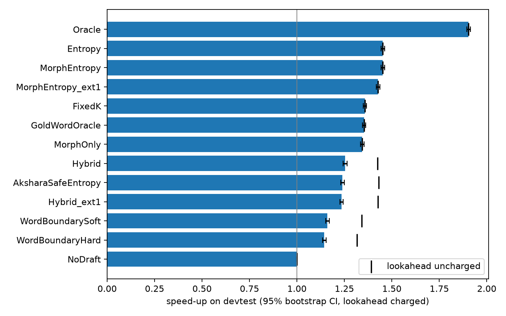
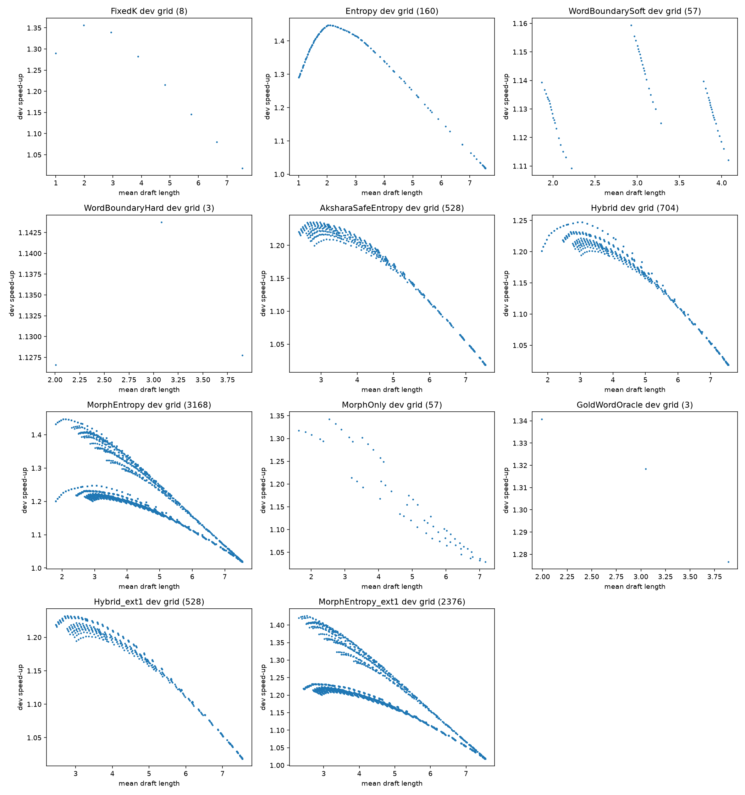
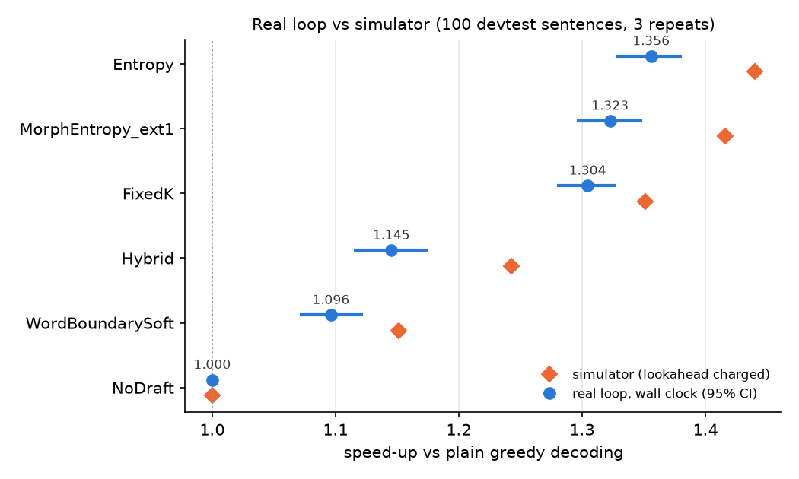

# Does Hindi word and morpheme structure help speculative decoding? Phase 1 report

CS769 course project (IIT Bombay). This report describes everything done in the first phase of the project, why it was done, and what came out. It is written to be read on its own. Every number is read from a file in `results/phase1/` by `scripts/make_report.py`; file names are given in brackets where they matter.

## 1. Summary

**Question.** Speculative decoding speeds up a large language model by letting a small *draft* model guess several tokens that the large *target* model then checks in one step. How many tokens to guess each time is decided by a *stopping policy*. Hindi words are split by the tokenizer into several pieces, often in the middle of a written syllable (an *akshara*). We asked whether word, morpheme or akshara boundaries tell us where the draft model goes wrong, beyond what the draft model's own confidence already tells us, and whether stopping policies that use those boundaries are faster.

**Answer for our setup (Llama-3-8B target, Llama-3.2-1B draft, English→Hindi translation): no.**

- The fastest stopping policy is a simple confidence rule ("stop when the draft is unsure", called *Entropy* below): **1.452×** speed-up [95% CI 1.444–1.461] on the test set. Always guessing the best fixed number of tokens (2) gives 1.357×. An *oracle* that knows in advance where the draft will be wrong gives 1.904×, so there is still room for better policies.
- None of the eight policies that use word, akshara or morpheme boundaries beats the confidence rule. The best one reaches 1.427× (-0.025, CI -0.028 to -0.022). Even an oracle that stops exactly at the true word boundaries reaches only 1.353×.
- The draft *does* fail more often at the start of a word: it agrees with the target on 65.9% of word-initial tokens but on 86.5% of third tokens in a word. But the draft is also much less confident there, and that explains it: among tokens with the same confidence, word-initial tokens are not harder (they agree +1.4 percentage points *more* often). Adding word and morpheme position to a model that predicts draft failures from confidence does not improve it (change in AUC -0.0001).
- Most results come from a fast simulator. We checked it with real speculative decoding on GPUs (100 test sentences). The real speed-ups put the policies in the same order, with the confidence rule fastest at **1.356×** in wall-clock time. The simulator is 3.4%–7.8% too optimistic, mostly because of a fixable inefficiency in our decoding loop rather than an error in the simulation.
- An earlier version of this project reported results for linguistic policies. Those numbers were invalid because of errors in the policy code (§3). For example, its "morpheme" policy never used a morpheme resource. The rebuilt pipeline reproduces the earlier fixed-length, confidence and oracle numbers within 0.029, so those parts of the earlier work were sound.

## 2. Background

### 2.1 Speculative decoding

A language model writes text one token at a time, and each token needs one full pass through the model. For a large model, that pass is slow. Speculative decoding works in *rounds*:

1. A small, fast **draft** model guesses the next *g* tokens, one after another.
2. The large **target** model processes all *g* guesses in **one** pass (about as expensive as producing a single token), and checks each guess against the token it would have chosen itself.
3. Guesses are accepted from the left until the first disagreement. At that point the target's own token is used instead. If all guesses are accepted, the target adds one more token for free.

With greedy decoding, the output is **exactly** what the target model would have written alone, so the method is *lossless*. The only question is speed. Each round costs *g* draft steps plus one target pass and produces (accepted guesses + 1) tokens. Guessing too few tokens wastes the cheap draft model; guessing too many wastes draft steps on tokens that will be rejected. The rule that decides when to stop guessing in each round is the **stopping policy**, and it is what this project studies.

### 2.2 Why Hindi might be special

Hindi is written in Devanagari. The unit a reader sees as one written syllable is an **akshara**: a consonant, optionally joined to further consonants by a *halant* (virama), followed by a vowel sign (*matra*) or other marks. For example, क्षे is one akshara made of क + ् + ष + े. Words are made of **morphemes**: a stem plus suffixes, e.g. घरों ('houses', oblique) = घर (stem) + ों (plural oblique suffix).

Modern tokenizers split text into byte-level pieces learned from mostly English data. They split Hindi badly. With the Llama-3 tokenizer, a Hindi word is on average 2.67 tokens, 54.3% of the cuts between tokens fall *inside* an akshara, and a 4-token guess ends in the middle of a word 60.6% of the time (§5).

**Hypothesis.** A stopping policy that knows where words, morphemes and aksharas end could stop at better places than one that looks only at the draft model's confidence. Ending a guess mid-word cannot lower acceptance by itself, since checking is token by token. Boundaries can only help if they carry information about *where the draft and target disagree*. So the precise question is:

> *Does linguistic structure predict where drafts fail, beyond what the draft model's confidence already captures? And can a stopping policy use it to be faster?*

Either answer is useful if the comparison is fair, which is why most of this phase went into making the comparison correct.

## 3. The earlier version of this project, and why it was redone

An earlier version of the project (three Jupyter notebooks, kept unchanged in `notebooks/pre_interim/`) reported these results on half of the FLORES+ test set:

| policy (earlier version) | speed-up | acceptance | mean draft length |
|---|---|---|---|
| fixed k=2 (best fixed) | 1.361 | 65.1% | 1.98 |
| entropy (lam=-0.37, beta=2.0) | 1.452 | 68.4% | 2.44 |
| word boundary | 1.335 | 62.3% | 2.09 |
| morpheme lookup | 1.066 | 37.4% | 6.57 |
| hybrid akshara | 1.287 | 69.0% | 1.21 |
| oracle (cap 8) | 1.905 | 100.0% | 2.63 |

(`earlier_results.json`.) A review of the code found that the three linguistic rows (word boundary, morpheme, hybrid) did not measure what they claimed. The fixed-length, confidence and oracle rows were sound. The problems and what this phase does instead:

| problem | what went wrong | what this phase does |
|---|---|---|
| The "morpheme" policy never used a morpheme resource | It looked words up in a placeholder list of 11 common function words (है, और, में, …). It almost never stopped, hence its mean draft length of 6.57 and its speed-up of 1.07×. The earlier explanation, low coverage of the MorphTok morpheme dataset, described something that had not run. | Real morpheme labels from MorphTok plus a trained segmenter for unknown words, and a model of morpheme boundaries that can be used while drafting (§6). |
| The "hybrid" policy had no confidence part, and its akshara test could not work | It was described as "entropy + akshara boundary" but only checked whether the word so far consisted of complete aksharas. Whether the last akshara is complete depends on the *next* token (क looks complete until ्ष arrives), so the test almost always passed and the policy stopped after about one token (mean draft length 1.21). | Policies that combine the confidence rule with an estimate, from the draft model's own prediction, of whether the next token continues the akshara or word (§7). |
| The word-boundary policy used information it did not have | To decide whether the current word was finished, it read the draft model's *next* token without paying for computing it. In a real decoder that costs one more draft step, so the comparison favoured this policy. | Every policy may read only what a real decoder knows. Reading the next prediction counts as one extra draft step and is charged. A guard in the code raises an error on any other read (§4.3). |
| Tokens were turned into text one by one | Byte-level tokens that hold part of a character decode to garbage (`\ufffd`) on their own, so boundaries were misplaced. | All boundaries are computed on bytes, with each token's byte span in the full text. |
| Boundaries were taken from the draft's tokens | What matters is the text that is actually kept, i.e. the target model's output. | Labels are computed on the target model's output text. |
| The correlation summary ignored the sign | An automatic message reported a negative correlation (r = −0.27) as support for the hypothesis. With 33,000 tokens every p-value is ≈ 0, so p-values said nothing. | Signed effect sizes with confidence intervals, descriptive tables, and an analysis that holds confidence fixed (§9). |
| Only the confidence rule was tuned | It got a 40 × 3 grid of settings; the linguistic policies got none. | Every policy family is tuned on a separate tuning set with a grid of comparable size (§7.2). |
| Tables used different test sets, and there was no tuning set | Settings were chosen on one half of the test set and reported on the other half, and the fixed-length table used all of it. | Tune on FLORES+ *dev* (997 sentences), report everything once on FLORES+ *devtest* (1012 sentences). |
| Losslessness was never checked | The reference outputs were generated in padded batches, which can differ slightly from one-at-a-time decoding in 16-bit arithmetic. | A real speculative decoder whose output is compared token by token with one-at-a-time decoding (§10). |

Because none of the earlier GPU outputs were kept, every model output, measurement and result in this report was regenerated from scratch.

## 4. Setup and method

### 4.1 Models, data and task

| item | setting |
|---|---|
| Target model | meta-llama/Meta-Llama-3-8B-Instruct, 16-bit floats, split across two NVIDIA T4 GPUs (Kaggle) |
| Draft model | meta-llama/Llama-3.2-1B-Instruct, 16-bit floats. It uses the same tokenizer as the target (checked in code). |
| Task | English→Hindi translation of FLORES+ sentences, chat prompt "Translate the following English sentence into Hindi. Output only the Hindi translation.", greedy decoding, at most 256 new tokens |
| Tuning set | FLORES+ **dev**: 997 sentences, 63,173 output tokens. Used for choosing every policy's settings and for building the morpheme model. |
| Test set | FLORES+ **devtest**: 1012 sentences, 66,106 output tokens. Used once, for the reported numbers. |
| Maximum draft length | 8 tokens per round for every policy |

### 4.2 How speed-up is measured

Times are measured on the same GPUs and expressed in units of one target step. Drafting one token costs **c = 0.323** (the 1B model takes about a third of the time of the 8B model). The target's pass over g guesses costs **verify(g)**, measured at 1.020 for g = 1 up to 1.074 for g = 8: checking 8 guesses costs barely more than writing one token. So one round costs g·c + verify(g) and produces (accepted + 1) tokens, and

> **speed-up = total tokens produced / total cost**, so plain decoding with the target alone = 1.0.

For example, a round that guesses 2 tokens and has both accepted costs 2 × 0.323 + 1.025 ≈ 1.67 and produces 3 tokens.

### 4.3 Traces, the simulator, and the fairness rule

Running real speculative decoding for every policy and every setting would need far more GPU time than we have. Instead we record **traces** once on GPU:

1. The target model translates every sentence with greedy decoding.
2. Both models read the target's output once (*teacher forcing*). At every position we store what the draft model would predict next: its most likely token, how confident it is, and probabilities of particular kinds of next token (one that starts a new word, punctuation, end of text, a vowel sign or other mark that continues an akshara). We also store the top 20 tokens of both models.

The **simulator** then replays any stopping policy over these traces on a CPU, in seconds. Within a round, the draft's guesses agree with the target exactly up to the first disagreement, so accepted tokens are exact. The one approximation is that after a wrong guess, a real draft model continues from its own wrong token, while the trace continues from the right one. This can only change *where a policy stops* after a mistake. §10 measures the effect with real decoding: it is small.

**Fairness rule.** A policy may only use what a real decoder knows when it makes its decision. After guessing g tokens, that is the draft model's predictions up to the g-th guess, the guesses themselves, and the text already accepted. Some linguistic policies want to know what comes *next* ("would the next token start a new word?"). That requires computing the draft model's prediction for the next position, which costs one extra draft step. We charge that cost (c) whenever such a *lookahead* policy decides to stop, and also report the result without the charge as an optimistic bound. The simulator enforces the rule: any read beyond what is allowed raises an error, and unit tests check this for every policy.

### 4.4 Statistics

All intervals are 95% confidence intervals from a bootstrap over sentences (1000 resamples, sentences drawn with replacement). Differences between two policies use a *paired* bootstrap (the same resampled sentences for both), which is much more precise than comparing two separate intervals.

### 4.5 Engineering

All logic is in a Python package (`src/lgmtp/`) with unit tests. The GPU work (generation, traces, timing, real decoding) runs on Kaggle as self-contained notebooks, generated from the package, that can resume if a session ends. Each GPU code path was first run on a CPU with the 1B model in both roles. For the real decoder this was done twice: once with draft = target (nothing is ever rejected) and once with deterministic noise added to the draft (about half the rounds have a rejection). The noisy test was added after the first GPU run of the decoder crashed when discarding rejected tokens from the model's memory (the library's `crop` function changed its argument convention). Mistakes in the code that were found and fixed along the way are recorded in the tests.

### 4.6 Checks that the rebuilt pipeline is right

| set | sentences | output tokens | draft guess = target token | draft entropy when right | draft entropy when wrong | target re-read = its output | outputs cut at 256 tokens |
|---|---|---|---|---|---|---|---|
| dev | 997 | 63,173 | 76.1% | 0.658 | 2.058 | 99.91% | 1 |
| devtest | 1012 | 66,106 | 76.1% | 0.659 | 2.090 | 99.90% | 0 |

The draft model agrees with the target on 76.1% of tokens (earlier version: 0.761), and c = 0.323 (earlier: 0.334). Entropy (uncertainty, in nats) is three times higher where the draft is wrong, which is why a confidence rule works. When the target re-reads its own output, its top choice differs from what it wrote at about 0.1% of positions. These are near-ties in 16-bit arithmetic (`traces_summary.json`).

We also re-ran the earlier version's exact evaluation (half of the test set, its settings grid, verification cost fixed at 1) on the new traces:

| policy | rebuilt pipeline | earlier version | difference |
|---|---|---|---|
| fixed k=2 | 1.378 | 1.361 | +0.017 |
| confidence rule | 1.473 | 1.452 | +0.021 |
| oracle | 1.934 | 1.905 | +0.029 |

All differences are below 0.03 (`legacy_protocol.json`), so the regenerated outputs and the new simulator agree with the earlier work where that work was correct.

## 5. How tokenizers split Hindi

Measured on the Hindi side of FLORES+ devtest (`notebooks/00_tokenizer_analysis.ipynb`). A *cut* is the point between two consecutive tokens.

| tokenizer | tokens per word | cuts at a word boundary | cuts inside an akshara | 4-token guess ends inside a word |
|---|---|---|---|---|
| meta-llama/Llama-3.2-1B-Instruct | 2.67 | 38.6% | 54.3% | 60.6% |
| Qwen/Qwen3.5-0.8B | 2.16 | 51.2% | 19.2% | 47.3% |
| Qwen/Qwen3.5-0.8B with an outdated pre-tokenizer (see below) | 3.33 | 33.0% | 46.4% | 66.4% |

The Llama numbers match the earlier version exactly (5/5 checks, `test1_regression.csv`). The earlier version also reported 3.33 tokens per word for Qwen3.5-0.8B. That number came from an older version of the `transformers` library, which loaded this tokenizer with the pre-tokenization rule of the older Qwen2 models. That rule splits text before every vowel sign. With the tokenizer's own definition, Qwen3.5 needs only 2.16 tokens per word, fewer than Llama. Re-applying the old rule reproduces 3.33 exactly (third row).

## 6. Linguistic labels

Every token of the target output gets labels describing where it sits: its position in its word, whether it starts inside an akshara, and whether a morpheme boundary follows it. The labels come from the target's output text, using each token's byte span.

### 6.1 Morpheme boundaries from MorphTok

**MorphTok** is a dataset of Hindi words segmented into morphemes (`hindi.csv`; checksum in `morphtok_info.json`). It was prepared as follows:

| MorphTok | count | treatment |
|---|---|---|
| rows in MorphTok | 72257 |  |
| rows whose pieces join back into the word | 61766 | kept |
| rows whose pieces do not (sandhi: sounds change at the join) | 10491 | dropped, because their boundary cannot be placed in the written word |
| distinct words in the resulting lexicon | 60721 |  |
| words with more than one segmentation | 1045 | all their boundaries are kept (union) |
| boundaries inside an akshara | 4916 of 47360 | moved to the start of that akshara, e.g. निकाल+ेगी → निका+लेगी |

Boundaries inside an akshara are moved because a token boundary can never usefully fall there: the vowel sign belongs to the consonant before it in writing.

**Words not in MorphTok** are segmented by a character-level CRF (conditional random field) trained on MorphTok. On 10% of word types held out from training it finds boundaries with precision 0.924, recall 0.930, **F1 0.927**, and gets 89.9% of words exactly right. For comparison, a boundary after every akshara scores F1 0.438. Held-out words often share stems with training words, so accuracy on truly new stems is probably lower.

Where the labels come from, for the words in the target outputs:

| output set | tokens in words | from MorphTok | from CRF | none (not Devanagari) | distinct words | distinct: MorphTok | distinct: CRF |
|---|---|---|---|---|---|---|---|
| dev | 23596 | 66.5% | 31.7% | 1.7% | 5144 | 34.6% | 60.2% |
| devtest | 24651 | 66.9% | 31.4% | 1.6% | 5310 | 35.4% | 59.4% |

(`morph_coverage.json`.) Two thirds of word tokens are covered by MorphTok itself; frequent words are mostly in the lexicon, rare ones mostly are not.

### 6.2 A morpheme signal usable while drafting

The labels above need the whole word. A stopping policy sees only the beginning of the current word (the part drafted so far). We therefore built a **prefix model** that estimates P(morpheme boundary here | the word so far). It counts, over MorphTok and the tuning-set outputs, how often a word that begins this way has a boundary at this point. When a prefix is rare it backs off to the last three, two or one aksharas, and finally to the overall rate (a minimum of 5 observations at each level). It never sees the test set (`prefix_model.pkl.gz`).

## 7. Stopping policies

### 7.1 The policies

*g* is the number of tokens guessed so far in the round, and *H* is the entropy of the draft model's prediction for the last guessed token (high = unsure). "Lookahead" marks policies that need the draft's prediction for the *next* position and pay one extra draft step for it (§4.3).

| policy | lookahead | rule |
|---|---|---|
| NoDraft |  | no draft model: plain decoding (speed-up 1 by definition) |
| FixedK |  | always guess exactly k tokens |
| Entropy |  | stop as soon as the draft is unsure: 1 − √(β·H) < λ, i.e. H above a threshold set by λ and β. This is the confidence rule from the literature (AdaEDL, SVIP). |
| WordBoundarySoft | yes | stop once g ≥ min_g and P(next token starts a new word) > τ |
| WordBoundaryHard | yes | stop once g ≥ min_g and the draft's next token does start a new word (the earlier word-boundary policy, now paying for its lookahead) |
| AksharaSafeEntropy | yes | Entropy rule, but when it fires, only stop if the current akshara is probably complete (P(next token is a vowel sign or other mark) < τ_m). Otherwise keep guessing, at most max_ext more tokens. |
| Hybrid | yes | Entropy rule, but only stop if the current word is probably complete (P(next token starts a new word) > τ_w). Otherwise keep guessing, at most max_ext more. |
| MorphEntropy | only with the akshara test | Entropy rule, but only stop if the prefix model (§6.2) says a morpheme boundary is likely (> τ_morph). Optionally also require a complete akshara. Otherwise keep guessing, at most max_ext more. |
| MorphOnly |  | stop once g ≥ min_g and P(morpheme boundary) > τ_morph (no confidence rule) |
| Oracle | (not real) | stop right before the first wrong guess. Not implementable; an upper bound. |
| GoldWordOracle | (not real) | stop exactly at the true word boundaries of the target's output. The best a pure word-boundary policy could do. |

### 7.2 Tuning

Each policy's settings were chosen on the tuning set (dev) by maximising simulated speed-up, with the lookahead cost charged. The confidence rule was tuned over λ and β (β ∈ {0.5, 1, 2, 4}). The policies built on it were tuned over the 11 λ values around the best Entropy setting × all four β, times their own settings. Grid sizes: FixedK 8, Entropy 160, WordBoundarySoft 57, WordBoundaryHard 3, AksharaSafeEntropy 528, Hybrid 704, MorphEntropy 3168, MorphOnly 57, GoldWordOracle 3, Hybrid_ext1 528, MorphEntropy_ext1 2376 (`grid_*.csv`). The chosen settings (`selected_params.json`):

| policy | chosen on dev |
|---|---|
| FixedK | {"k": 2} |
| Entropy | {"lam": -0.683, "beta": 4.0} |
| WordBoundarySoft | {"tau": 0.05, "min_g": 2} |
| WordBoundaryHard | {"min_g": 2} |
| AksharaSafeEntropy | {"lam": -0.746, "beta": 4.0, "tau_m": 0.7, "max_ext": 1} |
| Hybrid | {"lam": -0.621, "beta": 2.0, "tau_w": 0.2, "max_ext": 0} |
| MorphEntropy | {"lam": -0.683, "beta": 4.0, "tau_morph": 0.1, "use_akshara": false, "tau_m": 0.5, "max_ext": 0} |
| MorphOnly | {"tau_morph": 0.05, "min_g": 2} |
| GoldWordOracle | {"min_g": 1} |
| Hybrid_ext1 | {"lam": -0.683, "beta": 4.0, "tau_w": 0.2, "max_ext": 1} |
| MorphEntropy_ext1 | {"lam": -0.621, "beta": 4.0, "tau_morph": 0.1, "use_akshara": false, "tau_m": 0.5, "max_ext": 1} |

With the chosen λ and β, the confidence rule stops as soon as the draft's entropy exceeds **0.71 nats**.

**Two tuned policies switched their linguistic part off.** For Hybrid and MorphEntropy, the best setting on dev was max_ext = 0: never keep guessing past where the confidence rule stops. MorphEntropy then *is* the confidence rule, and Hybrid is the confidence rule plus a lookahead it never uses. That is already a result: tuning prefers to ignore the linguistic condition. To still measure what the condition does when it is used, we also tuned versions restricted to max_ext ≥ 1. They are named **Hybrid_ext1** and **MorphEntropy_ext1**.

## 8. Main results (simulated, test set)

| policy | speed-up [95% CI] | without lookahead charge | difference vs Entropy [95% CI] | guesses accepted | guesses per round | tokens per round | share of fixed-k → oracle gap closed |
|---|---|---|---|---|---|---|---|
| Oracle | 1.904 [1.895, 1.914] |  | +0.452 [+0.448, +0.456] | 100.0% | 2.630 | 3.577 | 100.0% |
| MorphEntropy | 1.452 [1.444, 1.461] |  | +0.000 [+0.000, +0.000] | 71.9% | 2.102 | 2.479 | 17.3% |
| Entropy | **1.452** [1.444, 1.461] |  | — | 71.9% | 2.102 | 2.479 | 17.3% |
| MorphEntropy_ext1 | 1.427 [1.418, 1.437] |  | -0.025 [-0.028, -0.022] | 66.0% | 2.534 | 2.640 | 12.7% |
| FixedK | 1.357 [1.350, 1.366] |  | -0.094 [-0.099, -0.090] | 65.1% | 1.978 | 2.259 | 0.0% |
| GoldWordOracle | 1.353 [1.345, 1.361] |  | -0.099 [-0.105, -0.093] | 64.4% | 1.966 | 2.248 | -0.9% |
| MorphOnly | 1.343 [1.335, 1.353] |  | -0.108 [-0.114, -0.103] | 59.6% | 2.539 | 2.486 | -2.6% |
| Hybrid | 1.253 [1.243, 1.264] | 1.424 | -0.199 [-0.203, -0.195] | 63.3% | 2.979 | 2.844 | -19.1% |
| AksharaSafeEntropy | 1.239 [1.231, 1.249] | 1.430 | -0.212 [-0.216, -0.209] | 64.6% | 2.773 | 2.759 | -21.6% |
| Hybrid_ext1 | 1.235 [1.226, 1.244] | 1.426 | -0.217 [-0.220, -0.214] | 64.3% | 2.781 | 2.753 | -22.5% |
| WordBoundarySoft | 1.161 [1.152, 1.171] | 1.341 | -0.291 [-0.296, -0.286] | 57.5% | 2.945 | 2.664 | -36.0% |
| WordBoundaryHard | 1.144 [1.135, 1.154] | 1.317 | -0.308 [-0.313, -0.302] | 55.3% | 3.101 | 2.683 | -39.0% |
| NoDraft | 1.000 [1.000, 1.000] |  | -0.452 [-0.461, -0.444] | 0.0% | 0.000 | 1.000 | -65.4% |

(`main_table.csv`.) *Guesses accepted* is the share of guessed tokens the target accepts. *Tokens per round* counts the target's extra token. The last column shows how much of the distance from the best fixed length to the oracle a policy covers.



**What the table shows.**

- The confidence rule is best. Every other real policy is slower, with a confidence interval entirely below zero, except MorphEntropy, which as tuned is identical to it (§7.2). The confidence rule covers 17.3% of the gap between the best fixed length and the oracle.
- The best linguistic policy, MorphEntropy_ext1, comes within 0.025 of the confidence rule. It is the confidence rule plus a morpheme condition, and the condition only costs speed.
- The lookahead policies lose even if the extra draft step were free: the best of them reaches 1.430× without the charge (AksharaSafeEntropy).
- Stopping at the *true* word boundaries (GoldWordOracle, 1.353×) is no better than a fixed length of 2. So the problem is not that the policies estimate word boundaries badly: word boundaries are not good places to stop.

**Where do the policies end their guesses?** Share of rounds whose last guessed token ends at a word boundary, inside an akshara, or at a morpheme boundary of the target text:

| policy | at a word boundary | inside an akshara | at a morpheme boundary |
|---|---|---|---|
| FixedK | 41.3% | 52.5% | 42.7% |
| Entropy | 30.5% | 61.7% | 31.9% |
| WordBoundarySoft | 92.7% | 5.6% | 93.5% |
| WordBoundaryHard | 97.8% | 1.6% | 98.0% |
| AksharaSafeEntropy | 59.6% | 28.6% | 62.1% |
| Hybrid | 27.0% | 64.7% | 28.4% |
| MorphEntropy | 30.5% | 61.7% | 31.9% |
| MorphOnly | 43.5% | 50.1% | 45.4% |
| Oracle | 63.2% | 33.1% | 64.2% |
| GoldWordOracle | 100.0% | 0.0% | 100.0% |
| Hybrid_ext1 | 62.0% | 31.3% | 63.8% |
| MorphEntropy_ext1 | 41.8% | 50.1% | 44.0% |

The linguistic policies do stop where they intend to (WordBoundarySoft ends 92.7% of rounds at a word boundary, against 30.5% for Entropy). But reaching those places means guessing more tokens, and more of them are rejected.

**Fixed draft lengths** (test set):

| k | guesses accepted | per-token acceptance estimate | tokens per round | guesses per round | speed-up |
|---|---|---|---|---|---|
| 1 | 74.8% | 0.748 | 1.730 | 1.000 | 1.288 |
| 2 | 65.1% | 0.751 | 2.259 | 1.978 | 1.357 |
| 3 | 57.7% | 0.756 | 2.662 | 2.940 | 1.342 |
| 4 | 51.2% | 0.756 | 2.949 | 3.888 | 1.283 |
| 5 | 45.9% | 0.757 | 3.169 | 4.824 | 1.211 |
| 6 | 41.7% | 0.759 | 3.350 | 5.751 | 1.148 |
| 7 | 38.0% | 0.759 | 3.481 | 6.663 | 1.082 |
| 8 | 34.8% | 0.759 | 3.577 | 7.566 | 1.018 |

(`fixed_k_devtest.csv`.) Guesses per round is slightly below k because a round never guesses past the end of the sentence.


Every setting tried on the tuning set, by policy family (speed-up against average guesses per round):




## 9. Where do drafts fail, and does linguistic structure add anything to confidence?

This section looks at single tokens rather than policies: for each output token, did the draft model's guess match the target (given the correct text so far)? All tables are on the test set.

**By position in the word** (0 = first token of a word):

| position in word | tokens | mean draft entropy | draft = target | mean target prob. of draft guess | share of tokens |
|---|---|---|---|---|---|
| 0 | 26852 | 1.517 | 65.9% | 0.537 | 40.6% |
| 1 | 21965 | 0.740 | 80.6% | 0.735 | 33.2% |
| 2 | 10189 | 0.519 | 86.5% | 0.812 | 15.4% |
| 3 | 4609 | 0.541 | 86.3% | 0.808 | 7.0% |
| 4+ | 2491 | 0.581 | 84.5% | 0.795 | 3.8% |


**By where the token starts** (inside an akshara, inside a word between aksharas, at the start of a word):

| token starts | tokens | mean draft entropy | draft = target | mean target prob. of draft guess | share of tokens |
|---|---|---|---|---|---|
| mid-akshara | 34998 | 0.627 | 83.4% | 0.771 | 52.9% |
| mid-utf8 | 74 | 0.311 | 95.9% | 0.925 | 0.1% |
| mid-word | 4182 | 0.841 | 80.1% | 0.736 | 6.3% |
| word-initial | 26852 | 1.517 | 65.9% | 0.537 | 40.6% |

**By whether a morpheme (or word) boundary follows the token:**

| boundary after token | tokens | mean draft entropy | draft = target | mean target prob. of draft guess | share of tokens |
|---|---|---|---|---|---|
| False | 38396 | 1.259 | 71.6% | 0.613 | 58.1% |
| True | 27710 | 0.645 | 82.2% | 0.758 | 41.9% |

**By kind of token:**

| token kind | tokens | mean draft entropy | draft = target | mean target prob. of draft guess | share of tokens |
|---|---|---|---|---|---|
| devanagari | 62774 | 1.005 | 76.0% | 0.672 | 95.0% |
| digit | 561 | 0.643 | 84.5% | 0.788 | 0.8% |
| latin | 382 | 2.230 | 35.1% | 0.297 | 0.6% |
| other | 138 | 2.629 | 13.0% | 0.112 | 0.2% |
| punct | 994 | 1.148 | 74.5% | 0.629 | 1.5% |
| space/special | 1257 | 0.310 | 95.1% | 0.919 | 1.9% |

Word-initial tokens are the hard ones: the draft has to choose the next *word*, while later pieces of a word are mostly determined by its beginning. Latin-script tokens (names, numbers written in Latin script) are the hardest of all, but rare.

**Correlations** of draft entropy with the labels (point-biserial r, signed; 95% CI):

| pair | r | lo | hi | r (tuning set) |
|---|---|---|---|---|
| entropy vs word_initial | +0.375 | +0.367 | +0.382 | +0.371 |
| entropy vs token ends a word | -0.243 | -0.249 | -0.237 | -0.239 |
| entropy vs draft = target | -0.537 | -0.543 | -0.530 | -0.528 |
| entropy vs morph_boundary_after | -0.266 | -0.272 | -0.260 | -0.262 |

The draft is more uncertain at word starts (r > 0) and less uncertain at the end of words and morphemes. The strongest relation is between entropy and being right (r ≈ −0.54).

### 9.1 The key test: same confidence, different position

Word-initial tokens fail more, but they also have higher entropy. Is position informative *on top of* entropy? Two tests:

**(a) Compare within confidence bands.** Split tokens into ten equal-size bands of draft entropy. Within each band, compare how often the draft is right for word-initial tokens vs other tokens (likewise for tokens that start a morpheme), then average over bands, weighted by size:

| set | comparison | raw difference | difference at equal entropy | CI low | CI high |
|---|---|---|---|---|---|
| test | word-initial vs other | -17.1 pts | +1.4 pts | +0.8 pts | +2.0 pts |
| test | morpheme-initial vs other | -17.0 pts | +1.3 pts | +0.8 pts | +1.9 pts |
| tuning | word-initial vs other | -16.4 pts | +1.7 pts | +1.1 pts | +2.4 pts |
| tuning | morpheme-initial vs other | -16.3 pts | +1.7 pts | +1.1 pts | +2.4 pts |

(`analysis_conditional_summary.csv`.) Without controlling for entropy, word-initial tokens are 17 points worse. At equal entropy the difference is small and *positive*: word-initial tokens are slightly *easier* than their entropy suggests.

**(b) Predict failures with and without position.** A logistic regression predicts "draft guess accepted" from confidence only (entropy and top-1 probability), and then from confidence + word-initial + morpheme-initial. If position carried extra information, the second model would separate right from wrong guesses better (higher AUC):

| quantity | test set | CI low | CI high | tuning set |
|---|---|---|---|---|
| standardised coefficient[H] (model with position) | +0.3001 | +0.2429 | +0.3609 | +0.2996 |
| standardised coefficient[top1] (model with position) | +1.7227 | +1.6597 | +1.7849 | +1.6912 |
| standardised coefficient[word_initial] (model with position) | +0.1084 | -0.0013 | +0.1993 | +0.0848 |
| standardised coefficient[morph_start] (model with position) | -0.1198 | -0.2036 | -0.0098 | -0.0836 |
| AUC, confidence only | +0.8718 | +0.8690 | +0.8750 | +0.8680 |
| AUC, confidence + position | +0.8717 | +0.8687 | +0.8749 | +0.8679 |
| change in AUC | -0.0001 | -0.0004 | +0.0000 | -0.0001 |
| change in log-likelihood per token | +0.0000 | +0.0000 | +0.0002 | +0.0000 |

(`analysis_conditional_devtest_logit.csv`; 200 bootstrap resamples.) Adding position changes AUC by −0.0001: no gain at all. The two position coefficients have opposite signs because every word start is also a morpheme start, so the two labels nearly duplicate each other. Only their joint effect (the AUC and log-likelihood change) is meaningful.

**Conclusion of this section.** Drafts fail at word starts *because* the draft is uncertain there, and entropy already measures that uncertainty. Once entropy is known, position adds nothing. This explains the policy results: a boundary condition can only move the stopping point away from where the confidence rule would put it.

## 10. Real speculative decoding on GPU

To check the simulator, we implemented real greedy speculative decoding. Both models keep a memory of the text so far (the KV cache), and rejected guesses are removed from it. We ran it on 100 randomly chosen test sentences (`real_loop_ids.json`) with six policies, using the settings chosen on the tuning set: NoDraft, FixedK, Entropy, WordBoundarySoft, Hybrid and MorphEntropy_ext1. The policies run through the same code as in the simulator. Each sentence was decoded 3 times per policy after a warm-up; we use the median time, and speed-up is total time of plain decoding / total time of the policy on the same sentences.

### 10.1 Results

| policy | real speed-up [95% CI] | difference vs Entropy [95% CI] | simulated speed-up | simulator too high by | tokens per second | tokens per round, real / simulated | identical to plain decoding |
|---|---|---|---|---|---|---|---|
| Entropy | 1.356 [1.328, 1.381] | — | 1.440 | 6.2% | 19.3 | 2.442 / 2.452 | 285/300 |
| MorphEntropy_ext1 | 1.323 [1.295, 1.349] | -0.033 [-0.044, -0.022] | 1.416 | 7.0% | 18.8 | 2.610 / 2.612 | 288/300 |
| FixedK | 1.304 [1.280, 1.328] | -0.052 [-0.068, -0.035] | 1.351 | 3.6% | 18.7 | 2.247 / 2.248 | 285/300 |
| Hybrid | 1.145 [1.115, 1.175] | -0.211 [-0.225, -0.197] | 1.242 | 8.5% | 16.4 | 2.794 / 2.804 | 288/300 |
| WordBoundarySoft | 1.096 [1.071, 1.122] | -0.260 [-0.279, -0.239] | 1.151 | 5.0% | 15.7 | 2.643 / 2.646 | 285/300 |
| NoDraft | 1.000 [1.000, 1.000] | -0.356 [-0.381, -0.328] | 1.000 | 0.0% | 14.2 | 1.000 / 1.000 | 288/300 |

(`real_loop_ci.csv`, `sim_vs_real.csv`, `real_loop.csv`, `real_loop_lossless.csv`.)



*Real wall-clock speed-up with 95% confidence interval (blue), and the simulator's prediction for the same sentences (orange).*

- **Same ranking as the simulator.** The confidence rule is fastest at **1.356×**, and every other policy is slower with a paired confidence interval below zero. The closest is MorphEntropy_ext1 (-0.033). The two lookahead policies are the slowest.
- **The simulator gets acceptance right.** Tokens produced per round differ by at most 0.40% between simulation and reality.
- **The simulator is 3.4%–7.8% too optimistic about speed**, for reasons explained in §10.3.
- **Output check:** 285–288 of 300 decodes per policy are identical to plain one-at-a-time decoding. That includes NoDraft (288/300), which does no guessing at all, so the differences are not caused by speculative decoding (§10.2).

Run details: build `git=a253e1ed509c-dirty src+artifacts_sha256=0f135c92b058`, transformers 5.22.1, torch 2.11.0+cu128, 2× T4 (`real_loop_run_info.json`).

### 10.2 Why some outputs differ from plain decoding

The same 11 sentences differ in all three repeats. At every first difference, the target model's top two candidate tokens have almost the same score (gap at most 0.0156, one or two rounding steps of 16-bit floats). Plain decoding without a draft differs too, on 4 sentences, and several differences occur at the same position for every policy. Processing tokens one at a time with a cache versus all at once changes rounding slightly, and that flips exact ties. Speculative decoding itself always keeps the target's top choice.

| sentence | token position | gap between top two | policies that differ here |
|---|---|---|---|
| 2 | 95 | 0.0156 | NoDraft, FixedK, Entropy, WordBoundarySoft, Hybrid, MorphEntropy_ext1 |
| 31 | 74 | 0.0000 | Entropy, Hybrid |
| 72 | 86 | 0.0000 | Entropy |
| 402 | 38 | 0.0156 | FixedK, WordBoundarySoft, Hybrid, MorphEntropy_ext1 |
| 503 | 9 | 0.0156 | NoDraft |
| 568 | 13 | 0.0000 | NoDraft |
| 676 | 16 | 0.0078 | NoDraft, FixedK, Entropy, WordBoundarySoft, Hybrid, MorphEntropy_ext1 |
| 686 | 32 | 0.0156 | FixedK, WordBoundarySoft |
| 871 | 26 | 0.0078 | FixedK |
| 899 | 42 | 0.0156 | WordBoundarySoft |
| 960 | 8 | 0.0156 | Entropy, MorphEntropy_ext1 |

### 10.3 Why the simulator is optimistic

We split the gap into four steps, each measured on the same sentences:

1. **Teacher forcing**: the simulator vs the real rounds (the draft lengths the real loop actually chose) priced with the simulator's cost model. This is the simulator's only approximation about policy behaviour (§4.3).
2. **Guessing past the end**: in the round that finishes a sentence, our real loop keeps guessing after the end-of-text token. The draft is confident there, and the target accepts tokens that are then thrown away. The simulator never guesses past the end.
3. **Cost model**: the same rounds priced with the cost model vs the measured time of each model call.
4. **Overhead**: model-call time vs total time (choosing tokens, trimming the cache, Python).

| policy | simulated | real | tokens guessed past the end, per sentence | 1 teacher forcing | 2 past the end | 3 cost model | 4 overhead | total |
|---|---|---|---|---|---|---|---|---|
| Entropy | 1.440 | 1.356 | 4.8 | -0.3% | -3.3% | -1.3% | -1.0% | -5.8% |
| FixedK | 1.351 | 1.304 | 0.7 | -0.5% | -0.5% | -1.6% | -0.9% | -3.4% |
| Hybrid | 1.242 | 1.145 | 6.0 | -1.4% | -3.6% | -2.5% | -0.6% | -7.8% |
| MorphEntropy_ext1 | 1.416 | 1.323 | 5.2 | -0.2% | -3.5% | -2.0% | -1.0% | -6.6% |
| WordBoundarySoft | 1.151 | 1.096 | 3.0 | -0.5% | -1.7% | -2.3% | -0.3% | -4.8% |

(`sim_vs_real_decomposition.csv`.)

- **Teacher forcing matters little** (0.2%–1.4%). Round by round, real and simulated decoding have the same share of rejected rounds and the same draft lengths (table below). After a wrong guess, the real draft continues slightly longer (for Entropy 0.246 vs 0.236 extra guesses per rejected round).
- **Guessing past the end is the largest effect** for the confidence-based policies (3.3% for Entropy, 4.8 wasted guesses per sentence). It is a flaw in our loop, not in the policies, and it slows every policy that guesses, so it does not change the ranking. Stopping the draft once it produces the end-of-text token keeps the output identical and would bring Entropy to about **1.40×**.
- **The cost model is accurate per round** (table at the end of this section). The 1.3%–2.5% step comes mainly from plain decoding being slightly faster in the loop (68.4 ms per token) than in the separate timing run (70.6 ms), which helps the baseline.
- **Overhead** is 2.9%–3.6% of total time for the policies that guess, against 2.6% for plain decoding: about 1% of speed-up.

**Rounds in real decoding (with the last round cut at the end of the sentence) vs the simulator** (`real_loop_after_mismatch.csv`):

| policy | source | rounds | rounds with a rejection | guesses (all accepted) | guesses (some rejected) | guesses after the first wrong one |
|---|---|---|---|---|---|---|
| FixedK | real | 2972 | 43.4% | 1.958 | 2.000 | 0.619 |
| FixedK | sim | 2968 | 43.3% | 1.958 | 2.000 | 0.619 |
| Entropy | real | 2724 | 48.6% | 2.053 | 2.110 | 0.246 |
| Entropy | sim | 2721 | 48.8% | 2.056 | 2.121 | 0.236 |
| WordBoundarySoft | real | 2526 | 49.6% | 2.717 | 3.115 | 1.502 |
| WordBoundarySoft | sim | 2521 | 49.5% | 2.720 | 3.199 | 1.584 |
| Hybrid | real | 2389 | 60.6% | 2.724 | 3.117 | 0.863 |
| Hybrid | sim | 2379 | 60.5% | 2.723 | 3.072 | 0.801 |
| MorphEntropy_ext1 | real | 2549 | 52.9% | 2.420 | 2.610 | 0.656 |
| MorphEntropy_ext1 | sim | 2554 | 53.1% | 2.411 | 2.614 | 0.643 |

**Measured vs modelled time per round**, by number of guesses g (all policies and repeats; extra = share of rounds with a lookahead step; `real_loop_cost_model.csv`):

| g | rounds | draft ms (measured) | draft ms (model) | verify ms (measured) | verify ms (model) | extra |
|---|---|---|---|---|---|---|
| 0 | 19947 | 0.013 | 0.000 | 68.410 | 70.589 | 0.0% |
| 1 | 9219 | 29.240 | 29.638 | 71.565 | 71.969 | 29.9% |
| 2 | 17106 | 50.353 | 51.111 | 71.846 | 72.373 | 24.1% |
| 3 | 5247 | 81.470 | 82.644 | 72.693 | 72.974 | 62.3% |
| 4 | 2874 | 104.312 | 105.738 | 73.100 | 73.611 | 63.6% |
| 5 | 1590 | 125.918 | 127.819 | 73.401 | 74.816 | 60.4% |
| 6 | 1170 | 144.588 | 147.034 | 73.494 | 75.027 | 44.6% |
| 7 | 696 | 166.927 | 169.695 | 73.972 | 75.224 | 44.0% |
| 8 | 1578 | 179.403 | 182.476 | 74.732 | 75.796 | 0.0% |

**Bottom line.** On real hardware the policies rank as the simulator says, and the confidence rule stays best. Simulated speed-ups are a few percent high in absolute terms, mostly because of a fixable flaw in our loop that affects all policies alike.

## 11. Conclusions

1. For English→Hindi translation with Llama-3 8B/1B, **draft confidence already captures what word, akshara and morpheme boundaries say about draft failures.** Failures cluster at word starts, but only because the draft is unsure there.
2. **No boundary-based stopping policy beats the confidence rule**, in simulation or on real hardware, even with fair tuning, even without charging for lookahead, and even with the true word boundaries.
3. **There is still a large gap to the oracle**, so better stopping is possible. It will have to come from better use of confidence and context rather than from boundaries, at least for Hindi.
4. **The simulator is reliable for comparing policies**: it ranks them like real decoding, and its acceptance figures are within half a percent.
5. **Hindi may be the wrong language to find a morphology effect.** Hindi writes postpositions as separate words (घर में "in the house"), so its morpheme boundaries mostly coincide with word boundaries. Marathi attaches them (घरात), so a morphology effect is more likely to show there.

**Next steps** (planned for the next phase): a learned stopping controller that combines confidence, context and linguistic features; Marathi, an English control and a second model family with a different tokenizer; an analysis of where the confidence rule loses to the oracle; and fixing the end-of-sentence flaw before the final timing run.

## 12. Limitations

- Simulated speed-ups use teacher-forced traces. Real decoding confirms the ranking but is a few percent slower in absolute terms (§10.3). Quote real speed-ups from §10, and use the simulated ones to compare policies.
- Real decoding was run on 100 sentences, not all 1012.
- c = 0.323 was measured with the 8B target split over two T4 GPUs, so every target step includes a transfer between GPUs. On a single large GPU, c and all speed-ups would change (the ranking probably much less).
- One language pair, one model family, greedy decoding, one domain (FLORES+ news/wiki sentences).
- 31% of morpheme labels come from the CRF segmenter, whose accuracy on new stems is probably below its held-out F1. MorphTok words whose morphemes change sound at the join (sandhi) were excluded.
- The best confidence-rule setting uses β = 4, the edge of its grid. A check with β = 8 changed the tuning speed-up by less than 0.001.

## Appendix: reproducing the results

```bash
pip install -e .                                  # Python 3.11; CPU-only torch is enough locally
pytest                                            # unit tests (tests needing the gated tokenizer skip without a login)
python scripts/smoke_cpu.py --part 01             # CPU test of the trace-generation code
python scripts/build_kaggle_notebooks.py 01       # -> kaggle/01_traces_v2.ipynb, run on Kaggle (SPLIT=dev, then devtest)
python scripts/download_morphtok.py && python scripts/build_morph.py   # MorphTok lexicon + CRF segmenter
jupyter nbconvert --execute notebooks/00_tokenizer_analysis.ipynb      # §5
jupyter nbconvert --execute notebooks/02_policies_v2.ipynb             # §6–§9
python scripts/smoke_cpu.py --part 03 --selected results/phase1/selected_params.json             # draft = target
python scripts/smoke_cpu.py --part 03 --selected results/phase1/selected_params.json --noise 2   # with rejections
python scripts/build_kaggle_notebooks.py 03       # -> kaggle/03_real_loop.ipynb, run on Kaggle
jupyter nbconvert --execute notebooks/04_real_loop_analysis.ipynb      # §10
python scripts/make_report.py                     # this report
```

Trace generation ran build `git=0a45b51ed3e2-dirty src_sha256=c75053076a02` (`run_info_*.json` in the trace output). A later CPU-only helper changes the hash of a rebuild; the GPU code is unchanged.

**Files in `results/phase1/`.** Main table `main_table.csv` · tuning grids `grid_*.csv` · chosen settings `selected_params.json` · token-level analysis `analysis_*.csv` / `.png` · morphology `morph*.json`, `morph_crf.pkl`, `prefix_model.pkl.gz` · tokenizer analysis `test1_*` · real decoding `real_loop*`, `sim_vs_real*` · earlier version's numbers `earlier_results.json` · suggested slide wording `../../docs/pre_interim/interim_slide_corrections.md`.
